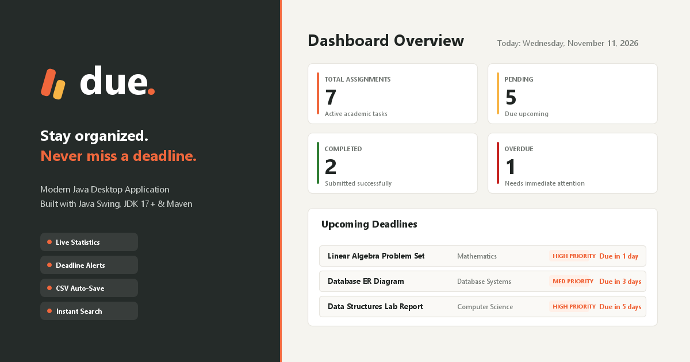

<div align="center">

# due.

### Stay organized. Never miss a deadline.

A modern, student-centric Java desktop application designed to organize academic coursework, manage deadlines, track completion status, and monitor progress with real-time statistics.



<br/>


</div>

---

## 🎨 Design System & Palette

**due.** features a warm, modern aesthetic designed for student focus:

| Color Role | Hex Code | Visual Preview | Description |
|---|---|:---:|---|
| **Dark Charcoal Sidebar** | `#252B29` |  | Grounded, high-contrast workspace navigation |
| **Warm Cream Background** | `#F5F4EF` |  | Soft canvas reducing eye strain during late study sessions |
| **Orange Accent** | `#F0673C` |  | Primary call-to-actions, brand accents & active indicators |
| **White Cards** | `#FFFFFF` |  | Clean, elevated data containers with rounded corners |
| **Main Text** | `#202523` |  | Deep charcoal for optimal typography readability |
| **Secondary Text** | `#777C78` |  | Muted labels, timestamps, and subtitles |
| **Subtle Borders** | `#E7E5DF` |  | Delicate borders defining cards and tables |

---

## ✨ Features

- 📊 **Dynamic Dashboard:** Live summary cards displaying Total, Pending, Completed, and Overdue assignments.
- ➕ **Add & Edit Assignment:** Input form with real-time validation for title, subject, date, priority, and status.
- 🗑️ **Delete Assignment:** Safely remove assignment records with confirmation dialogs.
- 🔍 **Real-Time Search & Filters:** Search by title or subject; filter instantly by All, Pending, Completed, or Overdue.
- 📅 **Deadline Tracking:** Automatic day calculations (remaining days, due today, due tomorrow, and overdue alerts) using `java.time.LocalDate`.
- ✅ **One-Click Completion:** Mark assignments complete with persistent status updates.
- 💾 **Permanent CSV Storage:** Auto-saves to `data/assignments.csv` with safe comma/quote escaping.

---

## 🎯 Java Concepts Demonstrated

| Concept | Implementation in **due.** |
|---|---|
| **Abstraction** | `TaskItem` abstract base class defining task properties & abstract methods |
| **Encapsulation** | Private fields with public accessors and mutators across models |
| **Inheritance** | `Assignment extends TaskItem` reusing task attributes and behavior |
| **Polymorphism** | Overriding `getStatusDisplay()` and `isOverdue()` invoked via `TaskItem` references |
| **Collections** | `ArrayList<Assignment>` powering all CRUD, search, and sorting logic |
| **File Handling** | Robust CSV parsing and serialization handling commas and quotation marks |
| **Swing Event Dispatch** | Thread-safe GUI updates on the Event Dispatch Thread (EDT) |

---

## 📂 Project Structure

```
AssignmentDeadlineTracker/
├── pom.xml                         # Maven build configuration
├── README.md                       # Project documentation
├── .gitignore                      # Git exclusions
├── assets/                         # Branding assets
│   ├── due-logo.png                # Transparent wordmark logo
│   ├── due-icon.png                # 512x512 application icon
│   └── due-thumbnail.png           # 1200x630 GitHub presentation banner
├── data/
│   └── assignments.csv             # Persistent CSV storage
└── src/
    ├── main/
    │   └── java/
    │       └── com/student/tracker/
    │           ├── Main.java                  # Entry point
    │           ├── model/
    │           │   ├── TaskItem.java          # Abstract base class
    │           │   └── Assignment.java        # Assignment child class
    │           ├── manager/
    │           │   └── AssignmentManager.java # Business logic & ArrayList operations
    │           ├── storage/
    │           │   └── FileHandler.java       # CSV reading/writing & error handling
    │           └── ui/
    │               ├── Dashboard.java         # due. main window & sidebar
    │               ├── AddAssignmentForm.java # Assignment creation & editing form
    │               └── AssignmentTable.java   # JTable view with search and filters
    └── test/
        └── java/
            └── com/student/tracker/
                ├── AppTest.java               # Automated test suite
                └── FullSystemInspector.java   # Verification suite
```

---

## 🚀 How to Build and Run

### Prerequisites
- **Java JDK 17** or later (`java -version`)
- **Apache Maven 3.8+** (`mvn -version`)

### Step 1: Navigate to Project Directory
```bash
cd AssignmentDeadlineTracker
```

### Step 2: Compile with Maven
```bash
mvn clean compile
```

### Step 3: Package into Executable JAR
```bash
mvn clean package
```

### Step 4: Run the Application
```bash
java -jar target/AssignmentDeadlineTracker-1.0-SNAPSHOT.jar
```

*Alternative: Run directly via classpath:*
```bash
java -cp target/classes com.student.tracker.Main
```

---

## 👨‍💻 Developer

**Anshul Kameriya**  
B.Tech – Computer Science and Engineering  
Avantika University

---

## 📄 License

This project is developed for educational and academic purposes.
